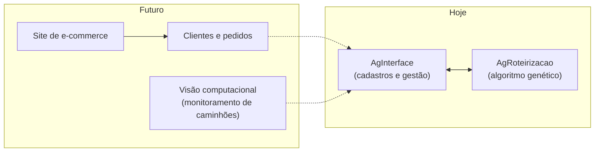
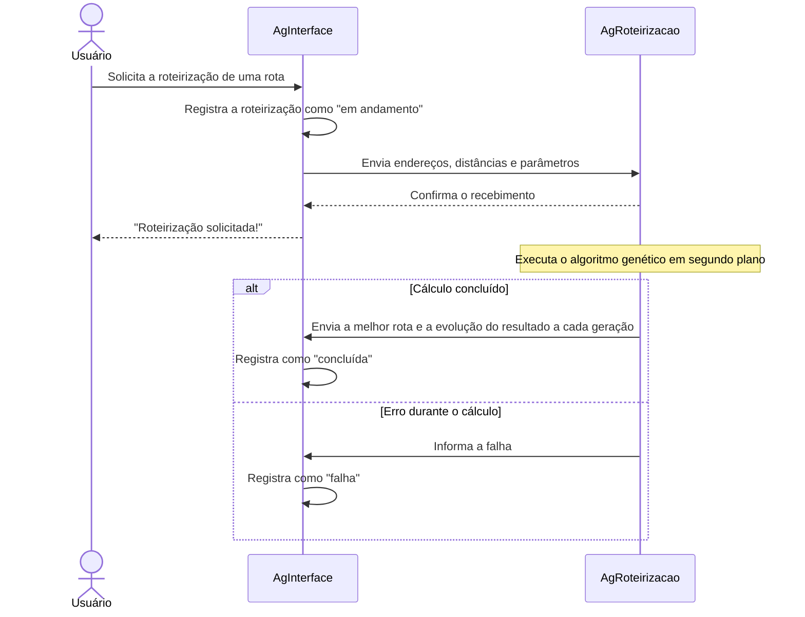

# AgRoteirizacao

Roteirização de entregas e coletas com algoritmo genético.

> [!NOTE]
> Projeto pessoal, em desenvolvimento. O escopo ainda **não está completo**: o sistema está sendo construído em etapas, e cada etapa representa um novo cenário ou restrição do mundo real.

## Sobre o projeto

O **AgRoteirizacao** é o serviço que calcula a melhor ordem para visitar um conjunto de endereços. Ele usa um **algoritmo genético**, uma técnica de otimização inspirada na evolução natural, para reduzir o custo de rotas de entrega e de coleta.

Ele não funciona sozinho. Faz parte de uma solução formada por dois projetos que se comunicam:

| Projeto | Papel |
|---|---|
| **[AgInterface](https://github.com/joaof99/algoritmo-genetico-administrativo)** | Sistema administrativo: cadastra endereços e rotas, solicita a roteirização e guarda o resultado |
| **AgRoteirizacao** (este repositório) | Motor de cálculo: recebe a rota, executa o algoritmo genético e devolve a melhor ordem de visita |

## O problema que ele resolve

Em logística, a ordem em que os endereços são visitados muda o custo final: quilômetros rodados, combustível, tempo do motorista, desgaste do veículo. Com poucos endereços, dá para testar todas as ordens possíveis. Mas o número de combinações cresce de forma explosiva: com 15 endereços já existem mais de **1 trilhão** de ordens diferentes.

O algoritmo genético não testa todas as combinações. Ele parte de um conjunto de rotas aleatórias e faz com que elas "evoluam" ao longo de várias gerações, combinando as melhores e introduzindo pequenas variações. O resultado é uma rota muito boa, encontrada em pouco tempo.

## Relevância

- **Impacto direto no custo das empresas.** O transporte está entre as maiores despesas de qualquer operação que entrega ou coleta mercadorias. No e-commerce, a etapa final da entrega, até a porta do cliente, costuma ser a mais cara de toda a cadeia. Uma rota mais curta reduz combustível, horas de trabalho e manutenção dos veículos todos os dias, em cada entrega.
- **Benefício ambiental.** Menos quilômetros rodados significam menos emissão de poluentes e menos veículos ocupando as ruas.
- **Um problema real e difícil.** Encontrar a melhor ordem de visita é uma variação do clássico **Problema do Caixeiro-Viajante**, um dos problemas de otimização mais estudados da computação. Não existe forma conhecida de resolvê-lo de maneira exata e rápida quando o número de endereços cresce, e é por isso que técnicas como o algoritmo genético são usadas na prática.
- **Aplicação que vai além da logística.** A mesma lógica serve para coletas, visitas técnicas, rotas de vendedores e transporte de pessoas. Qualquer cenário em que a ordem das paradas importa pode se beneficiar.
- **Base para decisões melhores.** Além de devolver a melhor rota, o sistema registra como o resultado evoluiu ao longo do cálculo, o que permite comparar parâmetros e entender o quanto a otimização trouxe de ganho.

## Visão de longo prazo

O objetivo final é **simular uma empresa de e-commerce completa**, com as regras e restrições de uma operação real. A logística é a primeira parte a ser construída.

Entre os planos para o futuro (distante) estão:

- um **site de e-commerce**, com clientes, pedidos e endereços de entrega;
- roteirização das entregas a partir dos pedidos gerados na simulação;
- **visão computacional** para o monitoramento dos caminhões;
- novas restrições do mundo real na roteirização, como capacidade dos veículos, janelas de horário e múltiplos veículos.



## Como os dois projetos se comunicam

A comunicação é **assíncrona**. O cálculo pode demorar, então o AgInterface não fica esperando: ele faz o pedido, recebe a confirmação na hora e o resultado chega depois.



## Tecnologias

- Java 23
- Servidor HTTP nativo do Java
- Jackson (JSON)
- Log4j 2 (logs)
- JUnit 5 e Mockito (testes)

## Como executar

Pré-requisitos: Java 23 e Maven.

1. Execute a classe `com.genetico.Main`. O serviço sobe na porta **8081**.
2. Por padrão, as respostas são enviadas ao AgInterface em `http://localhost:8080`. Para usar outro endereço, defina a variável de ambiente `AG_INTERFACE_URL`.
3. Para o fluxo completo, o [AgInterface](https://github.com/joaof99/algoritmo-genetico-administrativo) também precisa estar em execução, pois é ele que envia os pedidos e recebe os resultados.

Para rodar os testes:

```bash
mvn test
```

## Evolução da arquitetura (em análise)

A comunicação entre os projetos foi pensada para crescer junto com a simulação. As tecnologias abaixo estão **em fase de estudo**, para avaliar se e como elas podem resolver ou refinar o que já existe à medida que o sistema ganhar escala:

| Tecnologia | O que está sendo avaliado |
|---|---|
| **RabbitMQ** | Troca de pedidos e resultados de roteirização por filas de mensagens, com entrega garantida e possibilidade de várias instâncias do motor de cálculo trabalhando em paralelo |
| **Padrão Transactional Outbox** | Garantia de que o registro da roteirização e o envio do pedido aconteçam sempre juntos |
| **Docker Compose** | Subir todo o ambiente (banco de dados, filas e serviços) com um único comando |
| **Resilience4j** | Políticas de nova tentativa e *circuit breaker* nas integrações com serviços externos |
| **Kafka** | Fluxos de eventos em grande volume, quando o e-commerce e o monitoramento dos caminhões existirem |

Nenhuma dessas tecnologias foi adotada ainda: a decisão depende dos resultados dessa análise.

## Autor

Desenvolvido por **João** como projeto pessoal de estudo.
